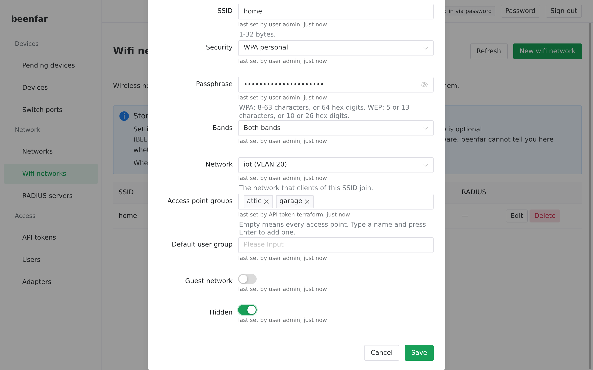

# LookMoreLike

The web UI for [beenfar](https://github.com/jacobalberty/beenfar), a network
controller. It is a Vue 3 single-page app that calls beenfar's API exactly as
the [Terraform provider](https://github.com/jacobalberty/terraform-provider-beenfar)
does, served from its own small container next to beenfard.



## What it does

| Screen | Notes |
|---|---|
| Sign in | Driven by what the controller offers: a password form, one button per OpenID Connect provider, or nothing in reverse-proxy mode (sign-out then goes to the proxy). |
| Pending devices | Adopt new devices, and accept the re-adoption of devices that were reset. Locked devices and devices awaiting re-adoption are labelled. |
| Devices, Switch ports | Adopted devices (forget them) and their port settings. |
| Networks, Wifi networks, RADIUS servers | Create, edit and delete. RADIUS shared secrets are write-only, with rotate. |
| API tokens | The secret is shown once, when the token is created. |
| Users, Adapters | Administrators only: users and passwords (not for single sign-on accounts), adapter health, and importing UniFi device keys. |

Screenshots of every screen are in [docs/screenshots](docs/screenshots).

### It never overwrites what another tool manages

Terraform manages some fields of a resource and the UI others, so an edit
sends an `update_mask` naming **only the fields you changed**, never the whole
object. Changing "hidden" on a wifi network leaves its access point groups
alone, even if Terraform set them. Etags cover the whole resource, so if
anything changed while you were editing, the UI shows what changed, does
**not** retry on its own, and lets you keep your edits on top of the latest
version or discard them.

Under each field of an edit dialog the UI shows what beenfar recorded:
"last set by API token *terraform-ci*, 3 days ago". That is a record of
writes, not a claim that anyone owns the field.

### What it cannot promise

beenfar stores settings; sending them to devices is a separate, optional step.
The UniFi `system_cfg` push is off by default, experimental and has not been
verified on hardware, switch port settings are never sent, and the push
refuses open, WEP and guest networks. beenfar does not report whether the push
is on, so the UI says that settings are *stored* and never implies they
reached a device.

## Running it

The UI and beenfar's API must be served from **one origin**: beenfar refuses
cookie-authenticated requests whose `Origin` is not its own `Host`. Put both
behind a reverse proxy that keeps the `Host` header and routes beenfar's paths
(`/beenfar.*`, `/api/`, `/auth/`, `/openapi.json`, `/healthz`) to beenfard and
everything else to this container. [examples/](examples) has complete Traefik
compose files for both layouts:

- [`traefik-same-domain.compose.yaml`](examples/traefik-same-domain.compose.yaml):
  UI and API on one domain, split by path;
- [`traefik-api-prefix.compose.yaml`](examples/traefik-api-prefix.compose.yaml):
  the API under a path prefix such as `/beenfar-api`, which the proxy strips.
  OpenID Connect then also needs `/auth/` routed unprefixed, because beenfar
  builds its callback URL without the prefix.

The routing rules in both were checked against a real Traefik, including
cookie sign-in through it. A URL on another origin is not supported.

The container (`ghcr.io/jacobalberty/lookmorelike`) runs as a non-root user on
port 8080. Its one setting:

| Variable | Default | |
|---|---|---|
| `LOOKMORELIKE_API_BASE` | `/` | Where beenfar's API is, as a path on this origin: `/` or a prefix such as `/beenfar-api`. Anything else stops the container with a message. |

## Developing

```sh
export NODE_AUTH_TOKEN=<a token with read:packages>   # see below
npm ci
BEENFARD_URL=http://127.0.0.1:8080 npm run dev         # proxies beenfar's paths to a running beenfard
npm run typecheck && npm run lint && npm test && npm run build
```

The API client is `@jacobalberty/beenfar-api`, generated by beenfar from its
protobuf files and published to the GitHub Packages npm registry with each
`api/vX.Y.Z` release. GitHub's registry asks for a token with `read:packages`
even for public packages (`.npmrc` reads it from `NODE_AUTH_TOKEN`). Dependabot
keeps the package current; it needs a `NPM_GITHUB_TOKEN` Dependabot secret.

### Tests

- `npm test`: unit and component tests (Vitest), including the update-mask,
  conflict and secret rules in `src/forms`.
- `scripts/container-smoke.sh <image>`: the built image's routes, cache and
  security headers, and `LOOKMORELIKE_API_BASE` handling.
- `npm run e2e`: Playwright against a real beenfard on a temporary SQLite
  database, with UniFi devices simulated by `e2e/simdevice` (go-unifi). Build
  the UI first and point `BEENFARD_BIN` at a beenfard binary:

  ```sh
  go build -o /tmp/beenfard github.com/jacobalberty/beenfar/cmd/beenfard
  npm run build && BEENFARD_BIN=/tmp/beenfard npm run e2e
  SCREENSHOT_DIR=docs/screenshots BEENFARD_BIN=/tmp/beenfard npm run e2e   # also refreshes the screenshots
  ```

  Not covered: a real OpenID Connect provider (the buttons and URLs are unit
  tested only) and anything on hardware.

## Releases

Images are published to `ghcr.io/jacobalberty/lookmorelike` (linux/amd64 and
linux/arm64), scanned with Trivy and signed with cosign:

| Tag | When |
|---|---|
| `latest`, `main` | every push to `main` that passes CI |
| `X.Y.Z`, `X.Y`, `X` | a release |

Cut a release by pushing a tag, or from the Actions tab (**Release**, "Run
workflow"):

```sh
git tag v1.2.3 && git push origin v1.2.3        # releases that tag
```

Run from the Actions tab with the version left empty, the workflow computes
the next one from the conventional commits since the last release (`feat!:` or
`BREAKING CHANGE` is a major bump, `feat:` a minor one, anything else a patch),
creates the tag, publishes a GitHub release with notes from those commits, and
builds the image. The publish fails on fixable HIGH or CRITICAL findings in the
image, so a release can be held up by a base-image update.

## License

GPL-3.0, like beenfar. See [LICENSE](LICENSE).
